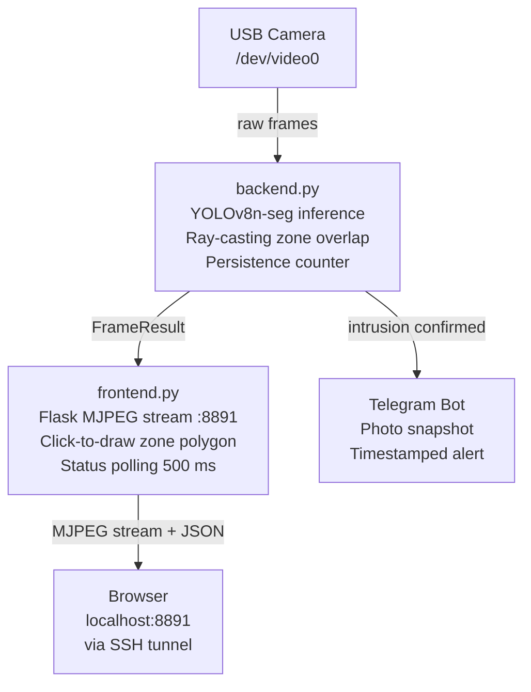

# SecureZone — Real-Time Restricted Area Monitoring

Edge-deployed restricted area monitoring system for an **NVIDIA Jetson Orin** (JetPack 6). It detects people with **YOLOv8n-seg instance segmentation**, checks whether any person's segmentation mask overlaps a user-defined polygon zone, and fires a **Telegram push alert** with a photo snapshot once an intrusion is confirmed across a persistence window. A browser-based MJPEG UI requires no display or X11.

---

## How It Works

1. **Detect** — YOLOv8n-seg runs on every camera frame, filtering to the person class (COCO class 0) at ≥ 0.50 confidence.
2. **Zone overlap** — The user draws a polygon in the browser by clicking on the live feed. For each detected person, the system checks whether any point of their segmentation mask contour lies inside the polygon using a **ray-casting algorithm**. If no mask is available it falls back to the bounding-box foot-point (bottom-centre) and corner checks.
3. **Persistence threshold** — A single-frame overlap does not trigger an alert. The system counts consecutive frames where a person is inside the zone. After **10 consecutive frames** the alert fires, eliminating false positives from momentary occlusions or misdetections.
4. **Alert** — A Telegram Bot API message is dispatched in a background thread with a JPEG snapshot and a timestamped caption. A 30-second cooldown prevents alert spam.
5. **UI** — Flask serves an MJPEG stream on port 8891. Zone state, alert status, FPS, persist counter, and an event log are updated every 500 ms via a `/status` JSON endpoint.

---

## System Architecture

---

## Project Structure
