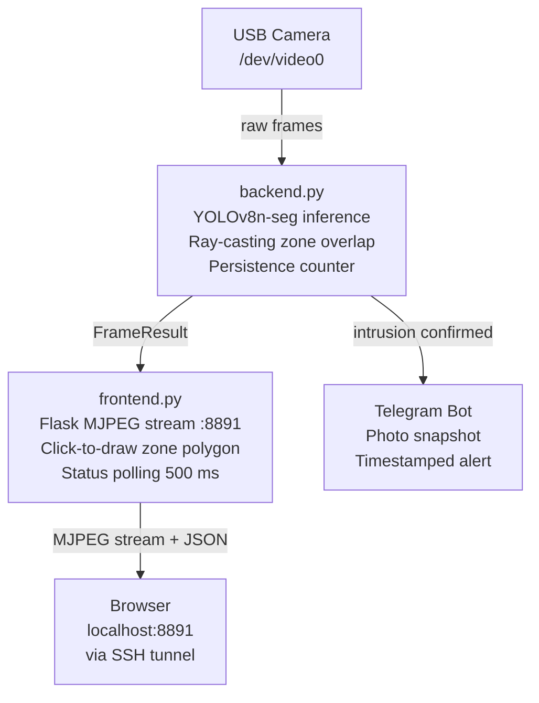

# SecureZone — Real-Time Restricted Area Monitoring

Edge-deployed restricted area monitoring system for an **NVIDIA Jetson Orin** (JetPack 6). It detects people with **YOLOv8n-seg instance segmentation**, checks whether any person's segmentation mask overlaps a user-defined polygon zone, and fires a **Telegram push alert** with a photo snapshot once an intrusion is confirmed across a persistence window. A browser-based MJPEG UI requires no display or X11.

---

## How It Works

1. **Detect** — YOLOv8n-seg runs on every camera frame, filtering to the person class (COCO class 0) at ≥ 0.50 confidence.
2. **Zone overlap** — The user draws a polygon in the browser by clicking on the live feed. For each detected person, the system checks whether any point of their segmentation mask contour lies inside the polygon using a **ray-casting algorithm**. If no mask is available it falls back to the bounding-box foot-point (bottom-centre) and corner checks.
3. **Persistence threshold** — A single-frame overlap does not trigger an alert. The system counts consecutive frames where a person is inside the zone. After **10 consecutive frames** the alert fires, eliminating false positives from momentary occlusions or misdetections.
4. **Alert** — A Telegram Bot API message is dispatched in a background thread with a JPEG snapshot and a timestamped caption. A 30-second cooldown prevents alert spam.
5. **UI** — Flask serves an MJPEG stream on port 8891. Zone state, alert status, FPS, persist counter, and an event log are updated every 500 ms via a `/status` JSON endpoint.

---

## System Architecture



---

## Project Structure
SecureZone-Real-Time-Monitoring/
│
├── backend.py
│ ├── BackendEngine load model, run process_frame() per frame
│ ├── TelegramAlerter non-blocking threaded Bot API sender with cooldown
│ ├── Detection bbox · confidence · mask contour · in_zone flag
│ ├── FrameResult result struct returned to frontend each frame
│ ├── point_in_polygon() ray-casting point-in-polygon test
│ ├── mask_overlaps_zone() check mask contour points against zone polygon
│ └── bbox_overlaps_zone() fallback: foot-point + four-corner check
│
├── frontend.py
│ ├── AppState thread-safe shared state (zone, alerts, FPS, log)
│ ├── camera_loop() daemon thread: read → infer → draw → encode → stream
│ └── Flask routes / /video_feed /add_point /close_zone
│ /reset_zone /screenshot /status
│
└── README.md


---

## Hardware & Software

| Component | Detail |
|---|---|
| Board | NVIDIA Jetson Orin Developer Kit |
| Container | `nvcr.io/nvidia/l4t-ml:r36.2.0-py3` |
| Python | 3.10 — conda env `yolo_gpu` |
| Model | YOLOv8n-seg (ultralytics 8.4.x) |
| Computer vision | OpenCV headless |
| Web server | Flask — MJPEG multipart stream |
| Push alerts | Telegram Bot API |
| Networking | USB ethernet (l4tbr0) + SSH tunnel |

---

## Setup

### 1. Configuration

Edit the constants at the top of `backend.py` before running:

```python
TELEGRAM_BOT_TOKEN   = "your_bot_token"
TELEGRAM_CHAT_ID     = "your_chat_id"
MODEL_PATH           = "/path/to/yolov8n-seg.pt"
CAMERA_INDEX         = 0
CONFIDENCE_THRESHOLD = 0.50
PERSISTENCE_FRAMES   = 10
ALERT_COOLDOWN_SEC   = 30
```

### 2. Run

```bash
# inside Docker container with yolo_gpu env active
python frontend.py
```

### 3. Access the UI

```bash
ssh -L 8891:localhost:8891 jetson@<jetson-ip>
# open in browser: http://localhost:8891
```

### 4. Draw a Zone

1. Click on the live video to place polygon vertices — minimum 3 points
2. Click **Close Zone** — the polygon locks in and monitoring begins
3. Walk into the zone; after 10 consecutive frames the alert fires
4. Click **Reset Zone** to clear and redraw at any time

---

## Results

| Metric | Value |
|---|---|
| Inference speed | ~24 FPS on Jetson Orin (YOLOv8n-seg) |
| End-to-end latency | < 100 ms — inference + zone check + JPEG encode + stream |
| False positive rate | Near-zero — persistence threshold eliminates single-frame noise |
| Alert delivery | Telegram photo within ~2 s of threshold crossing |

---

## Limitations

- Zone polygon and camera angle are configured manually per deployment; no automatic calibration.
- Confidence threshold and persistence window were tuned for indoor conditions; outdoor lighting or crowded scenes may require adjustment.
- Telegram alerts require internet access on the host; inference and the UI run fully offline.
- YOLOv8n-seg is optimised for speed; a larger model variant would improve accuracy at the cost of FPS.

---

## References

- [Ultralytics YOLOv8](https://github.com/ultralytics/ultralytics)
- [NVIDIA Jetson L4T ML Container](https://catalog.ngc.nvidia.com/orgs/nvidia/containers/l4t-ml)
- [Telegram Bot API](https://core.telegram.org/bots/api)
- Ray-casting algorithm: W. Randolph Franklin (1994)
